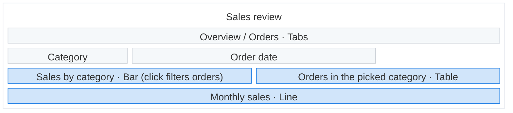

# Building a Data App

A **Data App** is one self-contained HTML file stored in Holistics. It runs in a sandboxed frame
with the SDK on the global `Anfra`: the SDK supplies data and state, and every pixel is yours. You
never run it against the user's data; the user does, and reports back.

References, in this file, read when a step needs them:

- [SDK reference](#anfra-sdk-author-api): every SDK call, the result shape, page structure and
  errors. **Read it before writing any code; do not invent APIs.**
- `generate_aql` drafts the query bodies; `execute_aql` runs each one before you save.
- [Example](#example): a complete app in the default Holistics look. Start the file from its
  skeleton and keep only the parts the agreed plan has; its dataset and field names are
  placeholders.

**No `create_data_app` tool** (a non-interactive run, or Data Apps not enabled): tell the user you
can't create Data Apps here, and stop.

## 1. Understand the request

Only the purpose must come from the user; the rest have defaults that the proposal shows.

1. **Purpose:** what the app is, who will use it, and what for ("a pipeline review for sales
   managers, to flag deals at risk"). Ask if the request doesn't say, without suggesting ideas.
   Also ask about a business term the dataset doesn't settle (net or gross revenue), with your
   recommended answer.
2. **Data:** use the datasets the user names. Otherwise pick the ones that fit from
   `list_datasets`, skipping archived or deprecated ones; ask only if two fit equally.
   `fetch_dataset` each and follow its relationships and caveats. If the data can't serve the
   purpose, say so and offer the nearest thing.
3. **Design:** the Holistics style unless the user wants another (see
   [Look and feel](#look-and-feel)). Derive the screens (tabs, panels, steps) and each interaction
   from the job; keep a tight instruction tight. Plan at most 4 charts or tables for the first
   version (see [Fit it in one reply](#fit-it-in-one-reply)).

## 2. Propose and confirm

Propose this to the user, and wait for their approval before building. On a change, update the
plan and wireframe and propose again.

````
## What's in the app
**App** — <what it is, such as "a metric catalog">
**For** — <who> **to** <what for>
**Data** — @Dataset:<dataset_uname> in <workspace>
**Assumptions** — <only choices that change a number: a term's meaning, the date field,
exclusions; leave the line out when there are none>



Build this app?
[Yes — build it as planned](#opt)
[Use a creative look instead](#opt)
[Use our brand colors](#opt)
````

- **Wireframe:** a `block:frame` with `columns 12`.
  - Spans: `3` = ¼, `4` = ⅓, `6` = ½, `12` = full. Every row adds up to 12; fill gaps with
    `space:<n>`. A nested `block:<id>:<span>` (a side rail) counts as its span.
  - Colors: the exact `classDef` lines, with `sect` for text, `ctrl` for filters and navigation,
    `viz` for charts, tables and KPIs.
  - Labels: `<name> · <type>`, plus how it behaves when that isn't obvious: what a click does
    (`· Bar (click filters orders)`), or the charts a control reaches when not all
    (`Grain · trend only`). A click can only filter charts on its own dataset.
- **Screens:** draw the app as the user first sees it, with its navigation where it sits (a
  `· Tabs` row, a rail block for a sidebar). Add a diagram only for a screen laid out differently
  (another tab, a panel that opens on a click), under a plain caption ("After clicking a rep").
- **These break the diagram:** a box id with anything but letters, digits and `_`; a box id of
  `end`; an unquoted label; a `"` inside a label (use `'`); a missing `end`.

## 3. Write the file

Write the app as one whole HTML document. Declare the queries, controls and mappings
(`createQuery`, `createFilter`, `createDateDrill`, `mapControl`, `mapCrossFilter`) that the agreed
screens and interactions need. Follow the example's skeleton: declare everything, `subscribe` a
render function, `execute()`, then wire controls and clicks to set state and `execute()` again.
Keep the look (styles, markup, chart theme) apart from the SDK wiring. Charts default to ECharts 6,
as in the example.

Done when the file keeps to the size rules below, holds every part of the approved plan and
nothing else, every part is marked, each query renders all four states and ran once through
`execute_aql` without error, every CDN asset carries its hash, the example's error banner script
is kept before every other script, and the metadata block has all five fields with known values or
explicit `null`s.

### Fit it in one reply

You write the whole file inside one `create_data_app` call, and one reply holds at most 8,192
output tokens: a longer file is cut off and never saved. Aim for about 15KB of HTML:

- Write no comments.
- Keep only the CSS rules, tokens and classes the page uses.
- Build at most 4 queries and 4 charts or tables in the first version, then offer to add more. When
  the plan holds more, build the first 4 and name the rest in that offer.
- Draw every chart and table through one shared render helper rather than repeating the setup per
  chart.
- Add a control (date presets, grain switch, cross-filter) only when the plan has it.

### Sandbox

The sandbox allows scripts only, has an opaque origin and a content policy:

- Data comes only from the SDK. `fetch`, XHR, WebSocket and `sendBeacon` are blocked except to the
  CDNs below; never call any service from the app.
- Libraries, styles and fonts load only from cdn.jsdelivr.net, cdnjs.cloudflare.com and Google
  Fonts, by pinned `https://` URL; esm.sh and unpkg.com are blocked. Load npm packages from jsDelivr
  (`/npm/<pkg>@<version>/<file>`, `+esm` for ES modules). Images may come from any `https://`
  server.
- Every CDN `<script src>` and `<link>` carries `integrity="sha384-…" crossorigin="anonymous"`, as
  in the example. You can't look a hash up and a wrong hash blocks the file, so use only the
  libraries, versions and hashes in the example. Load fonts from `@fontsource` on jsDelivr: Google
  Fonts' CSS can't be hashed.
- The app is its one HTML file: no relative `src` or `href`. Inline your scripts and styles, and
  images as SVG or a `data:` URI.
- `localStorage`, `sessionStorage` and cookies throw: keep state in variables, and follow
  `prefers-color-scheme` rather than Basecoat's theme switcher, which stores the mode.
- Forms, popups, navigation, `<iframe>` and `<base>` are blocked: use buttons and `change`
  listeners, never `<form>`.

### Names

Use names exactly as `fetch_dataset` gives them:

- A dataset's `uname` is what `dataset:` takes.
- A field is `model.field`, with the model name exactly as given (`ecommerce_orders.created_at`,
  not `orders.created_at`); a dataset metric is its bare name. A filter's or mapping's `field` is
  the same `model.field` the query uses.
- If a number the app needs has no field or metric, declare it as a query-local metric in the AQL.
  If AQL can't express it, tell the user it needs adding to the dataset; never compute it in
  JavaScript.

### Queries

Draft each `aql` with `generate_aql` when you need help with the syntax. The SDK applies the user's
state (filters, selection, sorts, date drills, page) to the query's `explore { }` before it runs,
so a pipe-style query fails as soon as a user touches a control, sort or date drill mapped to it.
Nothing a user changes goes in the AQL text: static conditions go in `filters`; a user's choice is
a control (`createFilter` + `mapControl`). Write flat table queries, not pivot queries (`rows { }` /
`columns { }`): pivot the rows in the app when it needs a pivot. Alias every dimension and measure
(`region: users.region`, `revenue: orders.total_revenue`): sorts, date drills, cross-filters and
row keys all go by the alias.

### Structure marks

Mark the page as [Structure](#structure) shows: `data-anfra-container` and `data-anfra-block`
(with a `data-anfra-label`) on its parts, and `data-anfra-query` or `data-anfra-control` on the
element each query and control draws into.

### Rendering

- Render each query's four states: `executing`, `success`, `error` (show `error.message`, and a
  distinct "you don't have access" for `PermissionError`), and success with no rows ("No sales this
  week", never a bare zero). A screen that waits on a pick says so ("Pick a rep to see their
  deals").
- Show the result of every interaction: a selection is visible (dimmed marks, a highlighted row, a
  chip) and can be cleared, and the page always shows the active tab or step, the filters applied
  and the way back from a drill or panel.
- On a selection change, restyle the marks already drawn (dim the unselected ones) rather than
  rebuild the chart, which would replay its entry animation on every click. With ECharts, merge a
  selection with a plain `setOption(option)` and keep `replaceMerge` for a new result.
- Put on the page the definitions, dates and rounding a user needs to trust a number.

### Metadata

Record generation metadata in the example's `data-app-metadata` block, the first child of
`<head>` after `<meta charset>`. Keep it static JSON, with every `<` escaped as `\u003c` so prompt
text cannot close the script tag:

- `prompt`: the user's first message describing the app, verbatim, never summarised or corrected.
  It never changes.
- `model` and `effort`: the model and reasoning effort the runtime or session explicitly gives for
  this revision; never infer them from the agent, product or task.
- `createdAt`: the first generation's UTC time in ISO 8601 (`"2026-09-24T14:30:00Z"`), read from a
  clock. Kept on later revisions.
- `updatedAt`: this revision's UTC time; on the first generation, equal to `createdAt`.

Any value you can't read is `null`, never a guess. When editing an older file, add the missing
fields the same way.

### Look and feel

An app must look finished without the user asking: no native controls, default buttons or unstyled
text. In every look (default, creative or their own design):

- A filter is a styled dropdown with search, multi-select for several values, never
  `<select multiple>`. For dates, two styled `<input type="date">` and preset buttons, as in the
  example. A preset sends its date phrase (`matches`, `last 30 days`) for the server to resolve, so
  a saved app stays current: never compute preset dates in the browser.
- Give ECharts hex colors: it cannot parse `oklch`.
- Lay out navigation, filter bars and grids with explicit `display`, `flex-direction`, sizing and
  wrapping, so a library's defaults can't change them.

Then by look:

- **Default style (Holistics):** start from the example, which maps Holistics' in-app tokens onto
  [Basecoat UI](https://basecoatui.com), with pinned CDN CSS and JS. Use its tokens as CSS
  variables, Inter, its text sizes (24px page title, 14px card titles and body, 12px captions),
  32px controls, one Blue 600 primary action and the chart palette (Blue 600 first). Green, purple
  and amber belong in charts and status, never on actions.
  - Filters are Basecoat comboboxes (`aria-multiselectable="true"` for several values). Basecoat's
    deferred script sets them up on `DOMContentLoaded`: add the options and call `refresh()` after
    that, as the example does.
  - Basecoat `.card` is a flex column that clips overflow. On a filter bar card set
    `flex-direction: row; align-items: flex-end; overflow: visible` (as `.card.filters` in the
    example), or the controls drift right and dropdowns get cut off.
  - Basecoat styles its own component classes, among them `.tabs`, `.chart`, `.table`, `.field`,
    `.empty`, `.sidebar`, `.card` and `.btn`. Use one only with Basecoat's markup for that
    component; give your own parts a prefixed class (`.app-tabs`, `.chart-box`), or Basecoat's
    layout overrides yours (a custom `.tabs` row renders as a column).
- **Creative:** your own palette, type and layout, in Basecoat or your own CSS, keeping readable
  contrast, tabular numerals, light and dark (`prefers-color-scheme`), and styled loading, empty
  and error states.
- **Their own design:** follow it. Take only the SDK wiring and the sandbox rules from the example,
  not its look.

## 4. Verify

1. **Run every query once** with `execute_aql` on its dataset and fix any error, and check every
   `createFilter` and `mapControl` field against `fetch_dataset`.
2. **Match the plan:** its screens, interactions and layout are built as agreed, and nothing else.
3. **Render it if you have a browser** (headless Chrome, Playwright), with a stub `Anfra` built
   from `fetch_dataset` (`datasets`, a `user`, and queries that return one made-up row). It catches
   syntax errors, crashes and broken layout, not AQL errors.

If you have not rendered the app, don't tell the user how it looks: say what the code is meant to
do, and ask for a screenshot when the layout matters.

## 5. Save and hand over

Save with `create_data_app`: `title`, the whole document as `code`, and a one-line
`description`; leave out `category_id`, since the user picks the folder. The chat shows the user a
folder picker; picking a folder is their approval to save the plan agreed in step 2, and the app is
saved there in the same call.

If `create_data_app` fails, nothing was saved:

- **Server error or timeout:** retry `create_data_app` once with the same arguments. The folder
  picker shows again.
- **Anything else** (the user cancelled or didn't answer, no permission in that folder or for Data
  Apps at all, the folder no longer exists, or no permission to edit the app you are replacing), or
  the retry fails too: tell the user in one sentence, following the error's message, and offer to
  help another way. Call `create_data_app` again only when the user asks.

On success, hand over the app exactly as the tool's `note` says, and tell the user, in their terms:

- what each screen is for, how to move between them, and what each control and click does;
- that you could not run it against their data, so they should open it (or use the preview in the
  chat), try every control and click, and check one headline number against one they trust.

If anything is off, ask for:

- what they see, against what they expected, with a screenshot for anything visual;
- the console panel contents;
- for a query that errored or looks wrong, its entry in the editor's Inspect panel (state,
  executed AQL, error), and any problems the panel shows on the structure tree.

## 6. Iterate

Read their report against [Errors](#errors), and compare a misbehaving query's executed AQL with
what you meant. A query marked "Not drawn yet" has no element marked with it. A handle the user
pastes is found as [Structure](#structure) says. A page that shows its static markup but nothing
the script fills in means the script never ran: the example's error banner names the line where it
failed.

Change the smallest thing that explains the problem, and restate a change first if it alters what a
number means. Run any changed query again with `execute_aql`, then save the whole updated file with
`create_data_app` and `overwrite_app_id` set to the `id` your own `create_data_app` call returned
earlier in this chat; no folder picker shows. Overwrite only that app, even when the user names
another one they can edit: tell them you can only change apps you created in this chat. Without
`overwrite_app_id` each call makes a new app. Tell the user that overwriting replaces any edits made
in the editor since. Preserve `prompt` and `createdAt`, refresh `model`, `effort` and `updatedAt`,
and repeat until the user says it's done.

Done when your reply hands over the app as the tool's `note` says.

---

# Anfra SDK: author API

Everything hangs off the global `Anfra`. It is ready before your first `<script>` runs: no
import, no setup, no await.

## Environment

- `Anfra.datasets`: `Record<key, descriptor>`, the datasets this reader can use, keyed by what a
  query's `dataset:` takes. A descriptor is
  `{ name, label, data_models: [{ name, label, fields: [{ name, label, type, is_custom_measure }] }], metrics: [{ name, label, type }] }`:
  `is_custom_measure` marks a model measure.
- `Anfra.user`: `{ id, name, email, role, timezone, permissions: { canViewGeneratedSql, canExportData } }`.
  The permissions are rendering hints only: the backend re-checks every query as this reader.
- `Anfra.plugins`: the plugins the host installed. See [Plugins](#plugins); never call one beyond `core`.

## Plugins

**`core` is always there.** It runs the queries and a filter's suggestions: everything below
(`createApp`, queries, controls, cross-filtering, structure) works through it. Never check for it.

The only other plugin Holistics installs is `inspect`, which adds nothing for the app: the editor's
Inspect panel reads the app's [structure](#structure) through it.

Nothing else is available: no `query.export`, no `Anfra.render`, no `Anfra.lineage`. If the user
asks for a download, an image or a PDF of the app, tell them the Data App can't offer one yet, and
don't build one from `query.result.rows` either.

## Field references

How you name a field **to the SDK** (in `createFilter` and `mapControl`):
`model.field` for a model field, a bare `name` for a dataset-level metric. Names come from
`Anfra.datasets`, never from labels. A filter's `field` is checked at once (a `ValidationError`
with a "did you mean"); a `mapControl` field is not checked until the query runs, so a typo there
arrives as a `QueryError`.

## App

```js
const app = Anfra.createApp({ title: 'Sales', timezone: 'Asia/Singapore' }); // both optional
```

Omit `timezone` to use the workspace's reporting timezone; set it to an IANA zone to evaluate relative dates and
date truncation in that zone. An HTML file may create several apps; one
is almost always right.

| Member | Does |
| --- | --- |
| `app.createQuery(name, { dataset, aql, pageSize? })` | Declares a query. Without `pageSize` it is not paged and returns every row. With one (a whole number of at least 1; anything else throws) it returns a page at a time: page further with `fetchMore()`. |
| `app.createFilter(name, decl)` | Declares a filter. See [Filter](#filter). |
| `app.createDateDrill(name, { default?, label? })` | Declares a date grain switch. See [Date drill](#date-drill). |
| `app.mapControl(control, query, { field, aggregation? })` | The control conditions `field` of `query`. |
| `app.mapCrossFilter(fromQuery, toQuery)` | Rows selected in `fromQuery` filter `toQuery`. |
| `await app.execute()` | Runs every query whose inputs changed. Resolves `{ succeeded, failed }`, never rejects. |
| `await app.refresh()` | Re-runs every query, whether or not its inputs changed. |
| `app.subscribe(fn)` | Calls `fn` on any change in the app or its entities. Returns an unsubscribe. |
| `app.hasChanges` | A control or the selection changed since the last execute: use for an "Apply" button. |
| `app.selection` / `app.clearSelection()` | The current cross-filter selection. |
| `app.abort()` | Cancels in-flight queries. |

Names are unique per app across queries and controls.

### Adding queries later

Entities and mappings can be declared at any time, including after `execute()`: the next
`execute()` runs whatever is new. A query's AQL is fixed once declared, and nothing can be removed,
so an app whose query changes with the reader's choices (a query builder, a pivot picker) declares
a **new query** for each new AQL:

- Give each one a unique name (`run1`, `run2`, …) and render only the latest.
- `query.abort()` the previous one if it may still be running.
- Earlier queries keep their last result and stay idle, since `execute()` only re-runs a query
  whose own inputs changed. A mapping can't be removed, though, so a control mapped onto an old
  query keeps re-running it. Give each new query its own controls, or start a fresh
  `Anfra.createApp()` and `abort()` the old app.

### Mappings are explicit

Nothing is wired for you. A filter on `users.region` affects no query until you
`mapControl(region, query, { field: 'users.region' })` for each query it should reach. The mapped
field need not be selected by the query. With `aggregation` (`'sum'`, `'avg'`, `'count'`,
`'count distinct'`, `'min'`, `'max'`, …) the condition applies to the aggregate, and the server puts
it in the query's `having`: a "revenue over 1000" filter is
`mapControl(minRevenue, byRegion, { field: 'orders.amount', aggregation: 'sum' })`. A mapping onto
a bare dataset metric is an aggregate condition too.

## Query

| Member | Does |
| --- | --- |
| `query.state` | `'idle' \| 'executing' \| 'success' \| 'error'` |
| `query.result` | `{ columns, rows, meta: { numRows, page?, pageSize? }, debug? }` (`page` and `pageSize` only for a paged query), or `undefined` before success. Kept while re-executing, so you can render stale data under a spinner. |
| `query.error` | The error when `state === 'error'`. |
| `query.setSort([{ field, direction }])` | Sorts by a result column `name`. `[]` restores the AQL's own sort. Re-run with `execute()`. |
| `query.hasMore` / `await query.fetchMore()` | Appends the next page. Unlike `execute`, `fetchMore` rejects on failure. A query with no `pageSize` has no more pages: `fetchMore` rejects with a `ValidationError`. |
| `query.select(rows, { fields? })` | Sets the app's selection from rows of this query. `fields` (result column aliases) limits which columns become conditions. See [Cross-filtering](#cross-filtering). |
| `query.selectedRows` | This query's rows that are currently selected, for highlighting. |
| `query.abort()` | Cancels this query's in-flight request. |
| `query.subscribe(fn)` | Change listener for just this query. |
| `query.locate()` | Scrolls to the elements marked with this query. See [Structure](#structure). |

### Result shape

```js
query.result.columns // [{ name, fieldName, modelId?, label, adhoc, isMeasure, aggregation?, semantic_type, arrow_type, db_type }]
query.result.rows    // [{ month: '2026-01-01', total: '1234.5' }, ...]
```

- Row keys are the **aliases your AQL declared** (`month`, `total`), matching `column.name`.
  `column.fieldName` is the underlying field, which you only need for debugging.
- Values are raw, never formatted. Format them yourself: a number with `Intl.NumberFormat`, which
  formats the string as it is (`money.format(row.revenue)`), and a date with `toLocaleDateString`
  and `timeZone: 'UTC'` on its date part, so the reader's timezone can't shift it a day.
- **Every number arrives as a string**, with every digit: `"9007199254740993"`, `"97537.24"`, and
  a float's `"NaN"`, `"Infinity"` or `"-Infinity"`. Dates arrive as ISO strings
  (`"2025-06-01T00:00:00Z"`), `null` as `null`.
- **Decide by `column.semantic_type`, never by `typeof`**: `number`, `text`, `date`, `datetime`,
  `truefalse`, `json`, `bit` (a true or false stored as a bit: `true`/`false`, or `"1"`/`"0"`), or
  `unknown` (a type AML gives no meaning yet).
- **Compute, chart or sort** with `Number(v)`. Never do arithmetic or `<` on the strings: `"1" + 2`
  is `"12"`, and `"10" < "9"` is true. Check for `null` first, since `Number(null)` is `0`.
  `Number(v)` keeps every digit of a `floating_point` column (`column.arrow_type.type`). An `int`
  with `bit_width` 64, or a `decimal`, can lose digits past about 15 significant digits: keep an
  ID as its string, and compare IDs with `===` on the strings.
- **Exact arithmetic**: prefer computing it in the query, as an aggregate or a metric (`sum`, `avg`,
  a ratio), which the database computes with every digit. Only when it must happen in the
  browser, give the string to a decimal library instead of `Number(v)` (`new Decimal(row.revenue)`
  with decimal.js or big.js), or to `BigInt` for whole numbers (`BigInt(row.id)`; its division
  drops the remainder).
- `column.label` is a display label; prefer it for axis and header text.
- `result.debug` has `executedAt`, `executedSql`, `fromCache`, and for an AQL query `executedAql`: your AQL
  with the reader's filters, sorts and date drills applied — the first thing to log when a
  control seems to do nothing.

## Structure

A definition can mark its parts in its HTML, so the editor's Inspect panel shows them as a
tree (hover to see one on the page, click to scroll to it, Pick to go from the page to the tree),
and so an author can hand an agent a handle for one. Mark every part the app renders; it costs one
attribute each.

```html
<main data-anfra-container="page" data-anfra-label="Overview">
  <div data-anfra-container="controls" data-anfra-label="Controls">
    <label data-anfra-block="region-picker" data-anfra-control="region">…</label>   <!-- a block drawn by a control -->
  </div>
  <div data-anfra-container="kpis">
    <div data-anfra-block="revenue" data-anfra-query="totals">…</div>   <!-- a block drawn by a query -->
    <div data-anfra-block="orders"  data-anfra-query="totals">…</div>   <!-- the same query, another block -->
  </div>
  <section data-anfra-block="trend" data-anfra-label="Revenue over time">
    <div id="trend-chart" data-anfra-query="trend"></div>               <!-- the chart the query draws -->
    <select data-anfra-control="grain"></select>                        <!-- and its control, in the same block -->
  </section>
</main>
```

| Attribute | On | Means |
| --- | --- | --- |
| `data-anfra-container="<id>"` | any element | A container: holds anything. |
| `data-anfra-block="<id>"` | any element | A block: the smallest thing a reader sees as one. Holds no container or block. |
| `data-anfra-label="<text>"` | a container or block | Its display name in the tree. Optional. |
| `data-anfra-query="<name>"` | any element | This element is drawn by that query. Several names space-separated. On a block's own element it means the block is drawn by it. |
| `data-anfra-control="<name>"` | any element | The same, for a filter or date drill. |

- Names are the ones given to `createQuery`, `createFilter` and `createDateDrill`. In a file that
  creates several apps, write `app/name` with the app's index (`1/trend`); a bare name is app 0.
- Ids are required and unique per kind in the document.
- Every query and control marker sits in a block, or on a block's own element. A control that
  stands alone (a filter in a toolbar) gets a block of its own; a control that belongs to one chart
  (a grain switch in a chart's header) goes in that chart's block.
- The markup is optional, partial, and read only while the Inspect panel is open. A mistake (an
  unknown name, a duplicate id, a block inside a block) is shown on the node in the tree, never
  thrown. Elements added later (a table drawn on the first result) appear once they exist.
- `query.locate()` and `control.locate()` (a filter's or date drill's) scroll to the elements marked with that entity and show
  them for a moment, for a "find on page" button of the app's own. They return `false` when
  nothing is marked yet, and never throw.

**Handles.** A user who has picked a node in the panel may paste its handle into a request:
`[Revenue over time](data-anfra-block="trend")`, or just `data-anfra-block="trend"` when the
node has no label. The part in parentheses is the attribute as written in the file: search the
definition for it to find the element the user means, then change that element and what draws it.

## Filter

```js
// Field-backed: options come from the field, filtered by the reader's permissions.
const region = app.createFilter('region', { dataset: 'sales', field: 'users.region', label: 'Region' });
await region.loadOptions();        // or loadOptions('ap') to search; then read region.options

// Manual: you supply the type, plus a fixed list or nothing (free input).
const tier = app.createFilter('tier', { type: 'string', options: ['Gold', 'Silver'] });
```

Always pass `dataset:` alongside `field:`. It is only optional when the reader can see exactly one
dataset, which is rare.

Set a filter's value with a **condition**, then call `execute()`:

```js
region.setCondition({ operator: 'is', values: ['APAC', 'EMEA'] });  // IN list
region.setCondition({ operator: 'is', values: [] });                // no filter
region.reset();                                                     // back to the declared default
```

Useful operators by type (the full list is in the SDK's `Operator` type):

- any: `is`, `is_not`, `is_null`, `not_null`
- string: `contains`, `does_not_contain`, `starts_with`, `ends_with` (all case-insensitive)
- number: `greater_than`, `less_than`, `between` (`values: [lo, hi]`). A number filter's values are strings, as results give them: `values: ['100']`. A JS number throws, since it may already have lost digits.
- date: `between` (`['2026-01-01', '2026-03-31']`), `before`, `after`, `last`/`next`
  (`values: [7], modifier: 'day'`), `matches` (`['last 3 months']`, `['year to date']`: any
  phrase from [Natural Time Expression](https://docs.holistics.io/docs/datetimes/relative-dates.md),
  resolved by the server in the app's timezone)
- boolean: `is_true`, `is_false`

`matches_user_attribute` and the `transform_pop_*` operators are not supported; a query
they reach fails with a `QueryError`.

A condition with no values (or `operator: 'none'`) sends nothing: the query runs unfiltered. Give a
filter a starting value with `default: { operator, values }`.

## Date drill

```js
const grain = app.createDateDrill('grain', { default: 'month' });
app.mapControl(grain, trend, { field: 'orders.created_at' });
grain.setGrain('week'); // 'year' | 'quarter' | 'month' | 'week' | 'day' | 'hour' | 'minute'
```

The server finds every dimension of the query built directly on that exact field and redraws it
at the grain, so:

- Map to the **field reference** (`orders.created_at`), never the dimension's alias. A field no
  dimension is built on fails the query with a `QueryError`.
- The dimension must be **aliased**, and can be the raw field (`period: orders.created_at`) or
  already truncated (`period: date_trunc(orders.created_at, "month")` or
  `period: orders.created_at | month()`); the drill overrides any of them. A computed dimension
  that merely uses the field is left alone.
- The row key stays the alias whatever the grain, so give it a grain-neutral name like `period`.

## Cross-filtering

```js
app.mapCrossFilter(byRegion, trend);                    // one direction
app.mapCrossFilter(trend, byRegion);                    // add the other if both should drive

chart.on('click', (p) => {
  const row = byRegion.result.rows[p.dataIndex];
  const selected = byRegion.selectedRows;
  byRegion.select(selected.includes(row)
    ? selected.filter((picked) => picked !== row)
    : [...selected, row]);
  app.execute();
});
```

- `query.select(rows)` replaces the selection with the full array. Pass multiple rows together;
  the click handler above toggles each row in or out. `query.select([])` clears the selection.
- Conditions are **ANDed within each row, ORed between rows**: `(A and B) or (C and D)`.
  Selecting `(APAC, Aug 2025)` and `(EMEA, Oct 2025)` preserves those pairs rather than matching
  every combination of the two regions and months. Selecting Aug 2025 and Oct 2025 on a monthly
  chart includes those two months, leaving September out. The SDK builds the conditions from the
  selected rows and the applied date grain.
- Pass **row objects from `query.result.rows`**, never rebuilt objects: the SDK reads the dimension
  values off them.
- Only dimension columns become conditions; measures and query-local expressions are skipped. A
  dropped expression column sets `app.selection.lossy` and logs a warning.
- `query.select(rows, { fields: ['region'] })` narrows the conditions to those result column
  aliases (dimensions only). Naming a measure, a query-local expression or an alias missing from
  the last result throws a `ValidationError`.
- One selection per app: selecting in another query replaces it. The source query is never
  filtered by its own selection, so its `result` is the same object after a click: dim its
  unselected marks with `query.selectedRows`.
- Both queries must use the same dataset. No self-edges.
- Clear with `app.clearSelection(); app.execute();`.

## Errors

| Class | When | What to do |
| --- | --- | --- |
| `ValidationError` | Thrown synchronously while declaring: unknown dataset, unknown filter field, duplicate name, invalid mapping, disabled capability. | Fix the declaring line it names. It surfaces as an uncaught error in the console. |
| `QueryError` | Stored on `query.error`: the server rejected the AQL, a mapped field or operator, or the query failed. | Read the message, which names the AQL problem or the bad entry (`filters[0].field`); fix the AQL or the mapping. |
| `PermissionError` | Stored on `query.error`: this reader can't see the data. | Render "no access", not a failure. |
| `TransportError` | Network or session problem. | Show a retry. |

Every error has `entity`, the query or control name it concerns. Check the class with `err.name`
(`'PermissionError'`), since the classes themselves aren't exposed as globals.

---

# Example

A complete app in the default Holistics look. Start the file from its skeleton and keep
only the parts the agreed plan has.

```html
<!doctype html>
<html>
<head>
  <meta charset="utf-8">
  <script type="application/json" id="data-app-metadata">
  {
    "prompt": "Sales overview: revenue by region as a bar chart that filters a revenue trend, with region and date filters and a week/month/quarter switch",
    "model": null,
    "effort": null,
    "createdAt": null,
    "updatedAt": null
  }
  </script>
  <script>
    (() => {
      const show = (text) => {
        let banner = document.getElementById('app-error-banner');
        if (!banner) {
          banner = document.createElement('div');
          banner.id = 'app-error-banner';
          banner.setAttribute('role', 'alert');
          banner.style.cssText = 'position:fixed;inset:0 0 auto 0;z-index:2147483647;padding:8px 16px;' +
            'background:#E53E3E;color:#FFFFFF;font:13px/18px system-ui,sans-serif;white-space:pre-wrap';
          (document.body || document.documentElement).append(banner);
        }
        banner.textContent += (banner.textContent ? '\n' : '') + text;
      };
      window.addEventListener('error', (event) => {
        show(`Script error${event.lineno ? ` on line ${event.lineno}` : ''}: ${event.message}`);
      });
      window.addEventListener('unhandledrejection', (event) => {
        show(`Unhandled error: ${event.reason?.message ?? event.reason}`);
      });
    })();
  </script>
  <meta name="viewport" content="width=device-width, initial-scale=1">
  <title>Sales Overview</title>
  <link rel="stylesheet" href="https://cdn.jsdelivr.net/npm/@fontsource-variable/inter@5.2.5/index.css"
    integrity="sha384-ZTIcl2CmY0wyM9ANOhomBco7rEUIlWztf6lGcLKCocKUrIgGCsfisuZyE+hadW8K" crossorigin="anonymous">
  <link rel="stylesheet" href="https://cdn.jsdelivr.net/npm/basecoat-css@1.0.2/dist/basecoat.cdn.min.css"
    integrity="sha384-XWKdrxzE2X33lI8Q03C9fIbqdLWV11whVNycR2/3bMNJY73EEQOa7rmN+SeiSCor" crossorigin="anonymous">
  <script src="https://cdn.jsdelivr.net/npm/basecoat-css@1.0.2/dist/js/all.min.js"
    integrity="sha384-rD2ZCuReXV7nIneJcn1lsTn6yOv87YARLQyUsemVAxrYYHdy5hcAW8XZEQxx87Dj" crossorigin="anonymous" defer></script>
  <script src="https://cdn.jsdelivr.net/npm/echarts@6.1.0/dist/echarts.min.js"
    integrity="sha384-C2iskrW/uPW46KzOjrvJIQo4YkV8lkD+QS0CrDN18IIPIpT/g2USu8bTP3nvmIAD" crossorigin="anonymous"></script>
  <style>
    :root {
      --background: #F5F8FA;
      --foreground: #13151A;
      --card: #FFFFFF;
      --card-foreground: #13151A;
      --popover: #FFFFFF;
      --popover-foreground: #13151A;
      --primary: #1B7CE4;
      --primary-foreground: #FFFFFF;
      --secondary: #D1E5FA;
      --secondary-foreground: #104A89;
      --muted: #F5F8FA;
      --muted-foreground: #4C5159;
      --accent: #D1E5FA;
      --accent-foreground: #104A89;
      --destructive: #E53E3E;
      --border: #E3E7ED;
      --input: #CBD0D7;
      --ring: #1B7CE4;
      --radius: 0.5rem;
      --chart-text: #4C5159;
      --chart-grid: #EDF1F5;
      --chart-cat-1: #1B7CE4; --chart-cat-2: #259B6C; --chart-cat-3: #9250E5; --chart-cat-4: #E9AB4A;
      --chart-cat-5: #104A89; --chart-cat-6: #52C396; --chart-cat-7: #B184EC; --chart-cat-8: #8F99A3;
    }
    .dark {
      --background: #05264C;
      --foreground: #FFFFFF;
      --card: #0A3360;
      --card-foreground: #FFFFFF;
      --popover: #0A3360;
      --popover-foreground: #FFFFFF;
      --primary: #5EA3ED;
      --primary-foreground: #05264C;
      --secondary: #104A89;
      --secondary-foreground: #FFFFFF;
      --muted: #104A89;
      --muted-foreground: #D2D4D9;
      --accent: #104A89;
      --accent-foreground: #FFFFFF;
      --destructive: #E53E3E;
      --border: rgb(255 255 255 / 0.1);
      --input: rgb(255 255 255 / 0.16);
      --ring: #5EA3ED;
      --chart-text: #D2D4D9;
      --chart-grid: #104A89;
      --chart-cat-1: #5EA3ED; --chart-cat-2: #52C396; --chart-cat-3: #B184EC; --chart-cat-4: #E9AB4A;
      --chart-cat-5: #8DBEF2; --chart-cat-6: #7AD1AE; --chart-cat-7: #D0B5F4; --chart-cat-8: #B0B6BF;
    }

    body {
      font: 14px/20px "Inter Variable", Inter, system-ui, sans-serif;
      font-variant-numeric: tabular-nums;
      background: var(--background); color: var(--foreground);
      margin: 0; padding: 24px; max-width: 1280px; margin-inline: auto;
    }
    h1 { font-size: 24px; line-height: 36px; font-weight: 500; margin: 0; text-wrap: balance; }
    .caption { font-size: 12px; line-height: 16px; color: var(--muted-foreground); }
    .header { margin-bottom: 16px; }
    .btn, .input { height: 32px; font-size: 14px; }
    .combobox-chips { min-height: 32px; padding-block: 5px; }
    .card { border-radius: 12px; box-shadow: none; position: relative; }
    .card > header { padding-bottom: 0; }
    .card h2 { font-size: 14px; line-height: 20px; font-weight: 500; }
    .card > header.with-action { display: flex; align-items: center; justify-content: space-between; gap: 8px; }

    .card.filters { flex-direction: row; flex-wrap: wrap; gap: 16px; align-items: flex-end;
                    justify-content: flex-start; padding: 12px 16px; margin-bottom: 16px;
                    overflow: visible; }
    .field-group { display: flex; flex-direction: column; gap: 8px; }
    .field-group > label { font-weight: 500; }
    .date-range { display: flex; flex-wrap: wrap; align-items: center; gap: 8px; }
    .date-range .input { width: 9.5rem; }
    .presets { display: flex; gap: 4px; }

    .grid { display: grid; grid-template-columns: 1fr 2fr; gap: 16px; }
    @media (max-width: 800px) { .grid { grid-template-columns: 1fr; } }
    .chart-box { height: 320px; }
    .status { position: absolute; inset: 56px 16px 16px; display: none; align-items: center;
              justify-content: center; background: color-mix(in oklab, var(--card) 85%, transparent); }
    .status.visible { display: flex; }
    .status > * { width: 100%; }
    .status .skeleton { height: 100%; border-radius: 8px; }
    .status .empty { text-align: center; color: var(--muted-foreground); }
  </style>
</head>
<body>
<main data-anfra-container="page" data-anfra-label="Sales overview">
  <div class="header" data-anfra-block="title" data-anfra-label="Title">
    <h1>Sales overview</h1>
  </div>

  <div class="card filters" data-anfra-container="controls" data-anfra-label="Controls">
    <div class="field-group" data-anfra-block="region-picker" data-anfra-label="Region" data-anfra-control="region">
      <label for="region-input">Region</label>
      <div id="region-combobox" class="combobox" style="width: 260px" data-auto-highlight="true">
        <input id="region-input" type="text" role="combobox" placeholder="All regions" autocomplete="off"
               autocorrect="off" spellcheck="false" aria-autocomplete="list" aria-expanded="false"
               aria-controls="region-listbox">
        <div id="region-popover" data-popover aria-hidden="true">
          <div role="listbox" id="region-listbox" aria-orientation="vertical" aria-multiselectable="true"
               data-empty="No regions found."></div>
        </div>
        <input type="hidden" name="region" value="[]">
      </div>
    </div>

    <div class="field-group" data-anfra-block="date-picker" data-anfra-label="Order date" data-anfra-control="dates">
      <label for="date-from">Order date</label>
      <div class="date-range">
        <input id="date-from" class="input" type="date" aria-label="From">
        <span class="caption">to</span>
        <input id="date-to" class="input" type="date" aria-label="To">
        <div class="presets" role="group" aria-label="Quick range">
          <button class="btn" data-variant="outline" type="button" data-range="last 30 days" aria-pressed="false">30d</button>
          <button class="btn" data-variant="outline" type="button" data-range="last 90 days" aria-pressed="false">90d</button>
          <button class="btn" data-variant="outline" type="button" data-range="year to date" aria-pressed="false">YTD</button>
          <button class="btn" data-variant="secondary" type="button" data-range="" aria-pressed="true">All</button>
        </div>
      </div>
    </div>
  </div>

  <div class="grid" data-anfra-container="charts" data-anfra-label="Charts">
    <section class="card" data-anfra-block="by-region" data-anfra-label="Revenue by region">
      <header class="with-action">
        <h2>Revenue by region</h2>
        <button id="clear-selection" class="btn" data-variant="ghost" type="button">Clear selection</button>
      </header>
      <section><div id="by-region" class="chart-box" data-anfra-query="byRegion"></div></section>
      <div id="by-region-status" class="status"></div>
    </section>
    <section class="card" data-anfra-block="trend" data-anfra-label="Revenue over time">
      <header class="with-action">
        <h2>Revenue over time</h2>
        <div class="button-group" id="grain-group" role="group" aria-label="Date grain" data-anfra-control="grain">
          <button class="btn" data-variant="outline" type="button" data-grain="week">Week</button>
          <button class="btn" data-variant="secondary" type="button" data-grain="month" aria-pressed="true">Month</button>
          <button class="btn" data-variant="outline" type="button" data-grain="quarter">Quarter</button>
        </div>
      </header>
      <section><div id="trend" class="chart-box" data-anfra-query="trend"></div></section>
      <div id="trend-status" class="status"></div>
    </section>
  </div>
</main>

  <script>
    const darkQuery = window.matchMedia('(prefers-color-scheme: dark)');
    const applyTheme = () => document.documentElement.classList.toggle('dark', darkQuery.matches);
    applyTheme();

    function chartTheme () {
      const css = getComputedStyle(document.documentElement);
      const get = (name) => css.getPropertyValue(name).trim();
      return {
        text: get('--chart-text'),
        grid: get('--chart-grid'),
        cat: [1, 2, 3, 4, 5, 6, 7, 8].map((n) => get(`--chart-cat-${n}`)),
      };
    }

    const app = Anfra.createApp({ title: 'Sales Overview' });

    const byRegion = app.createQuery('byRegion', {
      dataset: 'ecommerce',
      aql: `
        explore {
          dimensions { region: users.region }
          measures { revenue: orders | sum(orders.amount) }
          sorts { revenue desc }
        }
      `,
    });

    const trend = app.createQuery('trend', {
      dataset: 'ecommerce',
      aql: `
        explore {
          dimensions { period: orders.created_at }
          measures { revenue: orders | sum(orders.amount) }
          sorts { period asc }
        }
      `,
    });

    const region = app.createFilter('region', { dataset: 'ecommerce', field: 'users.region' });
    const dates = app.createFilter('dates', { dataset: 'ecommerce', field: 'orders.created_at' });
    const grain = app.createDateDrill('grain', { default: 'month' });

    app.mapControl(region, byRegion, { field: 'users.region' });
    app.mapControl(region, trend, { field: 'users.region' });
    app.mapControl(dates, byRegion, { field: 'orders.created_at' });
    app.mapControl(dates, trend, { field: 'orders.created_at' });
    app.mapControl(grain, trend, { field: 'orders.created_at' });
    app.mapCrossFilter(byRegion, trend);

    const CURRENCY = 'USD';
    const money = new Intl.NumberFormat(undefined, { style: 'currency', currency: CURRENCY, maximumFractionDigits: 0 });
    const moneyShort = new Intl.NumberFormat(undefined, { style: 'currency', currency: CURRENCY, notation: 'compact', maximumFractionDigits: 1 });
    const num = (value) => (value == null ? null : Number(value));
    let selectedGrain = 'month';
    let resultGrain = selectedGrain;
    const periodLabel = (value) => {
      const date = new Date(`${String(value).slice(0, 10)}T00:00:00Z`);
      if (resultGrain === 'quarter') return `Q${Math.floor(date.getUTCMonth() / 3) + 1} ${date.getUTCFullYear()}`;
      const parts = resultGrain === 'week' ? { month: 'short', day: 'numeric' } : { month: 'short', year: 'numeric' };
      return date.toLocaleDateString(undefined, { ...parts, timeZone: 'UTC' });
    };
    const byRegionChart = echarts.init(document.getElementById('by-region'));
    const trendChart = echarts.init(document.getElementById('trend'));

    function renderStatus (query, elementId) {
      const el = document.getElementById(elementId);
      el.replaceChildren();
      if (query.state === 'executing') {
        el.append(Object.assign(document.createElement('div'), { className: 'skeleton' }));
      } else if (query.state === 'error') {
        const alert = Object.assign(document.createElement('div'), { className: 'alert' });
        alert.dataset.variant = 'destructive';
        const noAccess = query.error.name === 'PermissionError';
        const title = document.createElement('h2');
        title.textContent = noAccess ? "You don't have access to this data" : "Couldn't load this chart";
        const detail = document.createElement('section');
        detail.textContent = noAccess ? 'Ask your Holistics admin for access.' : query.error.message;
        alert.append(title, detail);
        el.append(alert);
      } else if (query.state === 'success' && query.result.rows.length === 0) {
        el.append(Object.assign(document.createElement('div'), { className: 'empty', textContent: 'No sales for these filters' }));
      }
      el.classList.toggle('visible', el.childElementCount > 0);
    }

    function axisStyle (theme) {
      return {
        axisLabel: { color: theme.text },
        axisLine: { lineStyle: { color: theme.grid } },
        splitLine: { lineStyle: { color: theme.grid } },
      };
    }

    function render () {
      renderStatus(byRegion, 'by-region-status');
      renderStatus(trend, 'trend-status');
      const theme = chartTheme();

      if (byRegion.result) {
        const rows = byRegion.result.rows;
        const selected = new Set(byRegion.selectedRows.map((row) => row.region));
        byRegionChart.setOption({
          textStyle: { color: theme.text },
          grid: { left: 8, right: 8, top: 16, bottom: 8, containLabel: true },
          tooltip: { valueFormatter: (v) => money.format(v) },
          xAxis: { type: 'category', data: rows.map((row) => row.region), ...axisStyle(theme) },
          yAxis: { type: 'value', axisLabel: { color: theme.text, formatter: (v) => moneyShort.format(v) }, splitLine: axisStyle(theme).splitLine },
          series: [{
            type: 'bar',
            itemStyle: { color: theme.cat[0], borderRadius: [4, 4, 0, 0] },
            data: rows.map((row) => ({
              value: num(row.revenue),
              itemStyle: { opacity: selected.size === 0 || selected.has(row.region) ? 1 : 0.3 },
            })),
          }],
        });
      }

      if (trend.result) {
        if (trend.state === 'success') resultGrain = selectedGrain;
        const rows = trend.result.rows;
        trendChart.setOption({
          textStyle: { color: theme.text },
          grid: { left: 8, right: 16, top: 16, bottom: 8, containLabel: true },
          tooltip: { trigger: 'axis', valueFormatter: (v) => money.format(v) },
          xAxis: { type: 'category', data: rows.map((row) => periodLabel(row.period)), ...axisStyle(theme) },
          yAxis: { type: 'value', axisLabel: { color: theme.text, formatter: (v) => moneyShort.format(v) }, splitLine: axisStyle(theme).splitLine },
          series: [{
            type: 'line', smooth: true, showSymbol: false,
            lineStyle: { color: theme.cat[0], width: 2 },
            itemStyle: { color: theme.cat[0] },
            areaStyle: { color: theme.cat[0], opacity: 0.08 },
            data: rows.map((row) => num(row.revenue)),
          }],
        });
      }
    }

    app.subscribe(render);
    darkQuery.addEventListener('change', () => { applyTheme(); render(); });

    byRegionChart.on('click', (params) => {
      const row = byRegion.result.rows[params.dataIndex];
      const selected = byRegion.selectedRows;
      byRegion.select(selected.includes(row)
        ? selected.filter((picked) => picked !== row)
        : [...selected, row]);
      app.execute();
    });

    const regionBox = document.getElementById('region-combobox');
    const regionList = document.getElementById('region-listbox');
    const domReady = document.readyState === 'loading'
      ? new Promise((resolve) => document.addEventListener('DOMContentLoaded', resolve))
      : Promise.resolve();
    Promise.all([region.loadOptions(), domReady]).then(([options]) => {
      regionList.replaceChildren(...options.map((value) => {
        const option = document.createElement('div');
        option.setAttribute('role', 'option');
        option.dataset.value = String(value);
        option.textContent = String(value);
        return option;
      }));
      regionBox.refresh();
    }).catch((err) => console.error('Could not load region options', err));
    regionBox.addEventListener('change', (event) => {
      const values = Array.isArray(event.detail.value) ? event.detail.value : [];
      region.setCondition({ operator: 'is', values });
      app.execute();
    });

    const fromInput = document.getElementById('date-from');
    const toInput = document.getElementById('date-to');
    const presets = document.querySelectorAll('[data-range]');
    const allPreset = document.querySelector('[data-range=""]');
    function pressPreset (pressed) {
      presets.forEach((button) => {
        const on = button === pressed;
        button.dataset.variant = on ? 'secondary' : 'outline';
        button.setAttribute('aria-pressed', String(on));
      });
    }
    function applyDateRange () {
      if (fromInput.value && toInput.value) {
        dates.setCondition({ operator: 'between', values: [fromInput.value, toInput.value] });
        pressPreset(null);
      } else {
        dates.setCondition({ operator: 'is', values: [] });
        pressPreset(allPreset);
      }
      app.execute();
    }
    fromInput.addEventListener('change', applyDateRange);
    toInput.addEventListener('change', applyDateRange);
    presets.forEach((button) => {
      button.addEventListener('click', () => {
        fromInput.value = '';
        toInput.value = '';
        const phrase = button.dataset.range;
        dates.setCondition(phrase
          ? { operator: 'matches', values: [phrase] }
          : { operator: 'is', values: [] });
        pressPreset(button);
        app.execute();
      });
    });

    document.querySelectorAll('[data-grain]').forEach((button) => {
      button.addEventListener('click', () => {
        document.querySelectorAll('[data-grain]').forEach((other) => {
          const on = other === button;
          other.dataset.variant = on ? 'secondary' : 'outline';
          other.setAttribute('aria-pressed', String(on));
        });
        selectedGrain = button.dataset.grain;
        grain.setGrain(selectedGrain);
        app.execute();
      });
    });

    document.getElementById('clear-selection').addEventListener('click', () => {
      app.clearSelection();
      app.execute();
    });

    window.addEventListener('resize', () => {
      byRegionChart.resize();
      trendChart.resize();
    });

    app.execute();
  </script>
</body>
</html>
```
