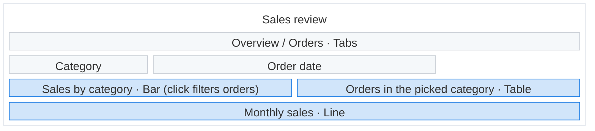

# Building a Data App

A **Data App** is one self-contained HTML file stored in Holistics. It runs in a sandboxed frame
with the SDK on the global `Anfra`: the SDK supplies data and state, and every pixel is yours. You
never run it against the user's data; the user does, and reports back.

To export or convert a claude.ai artifact, load the `convert-artifact-dashboard` skill instead.

References, read when a step needs them:

- [api.md](references/api.md): every SDK call, the result shape, page structure and errors. **Read it before
  writing any code; do not invent APIs.**
- [aql](../aql/) skill: writing the query bodies.
- [example.html](references/example.html): a complete app in the Holistics look. Start the file from its
  skeleton and keep only the parts the agreed plan has, restyled to the agreed look; its dataset
  and field names are placeholders.

**Tools:** `list_datasets`, `fetch_dataset`, `validate_aql` and `create_data_app`. If they aren't
available, load the `setup-holistics-mcp` skill first; without them the names are guesses and the
queries unchecked.

## 1. Understand the request

Only the purpose must come from the user; the rest have defaults that the proposal shows.

1. **Purpose:** what the app is, who will use it, and what for ("a pipeline review for sales
   managers, to flag deals at risk"). Ask if the request doesn't say, without suggesting ideas.
   Also ask about a business term the dataset doesn't settle (net or gross revenue), with your
   recommended answer.
2. **Data:** use the datasets the user names. Otherwise pick the ones that fit from
   `list_datasets`, skipping archived or deprecated ones; ask only if two fit equally.
   `fetch_dataset` each and follow its relationships and caveats. If the data can't serve the
   purpose, say so and offer the nearest thing.
3. **Design:** a creative look made for this app's audience and job, unless the user asks for the
   Holistics look or brings their own design (see [Look and feel](#look-and-feel)). Derive the
   screens (tabs, panels, steps) and each interaction from the job; keep a tight instruction tight.

## 2. Propose and confirm

Propose this to the user, and wait for their approval before building. On a change, update the
plan and wireframe and propose again.

````
## What's in the app
**App** — <what it is, such as "a metric catalog">
**For** — <who> **to** <what for>
**Data** — @Dataset:<dataset_uname> in <workspace>
**Assumptions** — <only choices that change a number: a term's meaning, the date field,
exclusions; leave the line out when there are none>
**Look** — <the direction in a few words, such as "calm executive brief: warm off-white, serif
headings, one deep-teal accent", or "Holistics">



Build this app?
[Yes — build it as planned](#opt)
[Try a different look](#opt)
[Match our brand](#opt)
````

- **Wireframe:** a `block:frame` with `columns 12`.
  - Spans: `3` = ¼, `4` = ⅓, `6` = ½, `12` = full. Every row adds up to 12; fill gaps with
    `space:<n>`. A nested `block:<id>:<span>` (a side rail) counts as its span.
  - Colors: the exact `classDef` lines, with `sect` for text, `ctrl` for filters and navigation,
    `viz` for charts, tables and KPIs.
  - Labels: `<name> · <type>`, plus how it behaves when that isn't obvious: what a click does
    (`· Bar (click filters orders)`), or the charts a control reaches when not all
    (`Grain · trend only`). A click can only filter charts on its own dataset.
- **Screens:** draw the app as the user first sees it, with its navigation where it sits (a
  `· Tabs` row, a rail block for a sidebar). Add a diagram only for a screen laid out differently
  (another tab, a panel that opens on a click), under a plain caption ("After clicking a rep").
- **These break the diagram:** a box id with anything but letters, digits and `_`; a box id of
  `end`; an unquoted label; a `"` inside a label (use `'`); a missing `end`.

## 3. Write the file

Write the app as one whole HTML document. Declare the queries, controls and mappings
(`createQuery`, `createFilter`, `createDateDrill`, `mapControl`, `mapCrossFilter`) that the agreed
screens and interactions need. Follow the example's skeleton: declare everything, `subscribe` a
render function, `execute()`, then wire controls and clicks to set state and `execute()` again.
Keep the look (styles, markup, chart theme) apart from the SDK wiring. Charts default to ECharts 6,
as in the example.

Done when the file holds every part of the approved plan and nothing else, every part is marked,
each query renders all four states, every CDN asset carries its hash, the example's error banner
script is kept before every other script, and the metadata block has all five fields with known
values or explicit `null`s.

### Sandbox

The sandbox allows scripts only, has an opaque origin and a content policy:

- Data comes only from the SDK. `fetch`, XHR, WebSocket and `sendBeacon` are blocked except to the
  CDNs below; never call any service from the app.
- Libraries, styles and fonts load only from cdn.jsdelivr.net, cdnjs.cloudflare.com and Google
  Fonts, by pinned `https://` URL; esm.sh and unpkg.com are blocked. Load npm packages from jsDelivr
  (`/npm/<pkg>@<version>/<file>`, `+esm` for ES modules). Images may come from any `https://`
  server.
- Every CDN `<script src>` and `<link>` carries `integrity="sha384-…" crossorigin="anonymous"`, as
  in the example. Copy the hash from the file's jsDelivr page and never guess one: a wrong hash
  blocks the file. Without a way to look one up, use only the example's libraries. Load fonts from
  `@fontsource` on jsDelivr: Google Fonts' CSS can't be hashed.
- The app is its one HTML file: no relative `src` or `href`. Inline your scripts and styles, and
  images as SVG or a `data:` URI.
- `localStorage`, `sessionStorage` and cookies throw: keep state in variables, and follow
  `prefers-color-scheme` rather than Basecoat's theme switcher, which stores the mode.
- Forms, popups, navigation, `<iframe>` and `<base>` are blocked: use buttons and `change`
  listeners, never `<form>`.

### Names

Use names exactly as `fetch_dataset` gives them:

- A dataset's `uname` is what `dataset:` takes.
- A field is `model.field`, with the model name exactly as given (`ecommerce_orders.created_at`,
  not `orders.created_at`); a dataset metric is its bare name. A filter's or mapping's `field` is
  the same `model.field` the query uses.
- A measure (`orders.total_revenue`) is used as the [aql](../aql/) skill says.
- If a number the app needs has no field or metric, declare it as a query-local metric in the AQL.
  If AQL can't express it, tell the user it needs adding to the dataset; never compute it in
  JavaScript.

### Queries

Write each `aql` with the [aql](../aql/) skill. The SDK applies the user's state
(filters, selection, sorts, date drills, page) to the query's `explore { }` before it runs, so a
pipe-style query fails as soon as a user touches a control, sort or date drill mapped to it.
Nothing a user changes goes in the AQL text: static conditions go in `filters`; a user's choice is
a control (`createFilter` + `mapControl`). Write flat table queries, not pivot queries (`rows { }` /
`columns { }`): pivot the rows in the app when it needs a pivot. Alias every dimension and measure
(`region: users.region`, `revenue: orders.total_revenue`): sorts, date drills, cross-filters and
row keys all go by the alias.

### Structure marks

Mark the page as [api.md](references/api.md#structure) shows: `data-anfra-container`
and `data-anfra-block` (with a `data-anfra-label`) on its parts, and `data-anfra-query` or
`data-anfra-control` on the element each query and control draws into.

### Rendering

- Render each query's four states: `executing`, `success`, `error` (show `error.message`, and a
  distinct "you don't have access" for `PermissionError`), and success with no rows ("No sales this
  week", never a bare zero). A screen that waits on a pick says so ("Pick a rep to see their
  deals").
- Show the result of every interaction: a selection is visible (dimmed marks, a highlighted row, a
  chip) and can be cleared, and the page always shows the active tab or step, the filters applied
  and the way back from a drill or panel.
- On a selection change, restyle the marks already drawn (dim the unselected ones) rather than
  rebuild the chart, which would replay its entry animation on every click. With ECharts, merge a
  selection with a plain `setOption(option)` and keep `replaceMerge` for a new result.
- Put on the page the definitions, dates and rounding a user needs to trust a number.

### Metadata

Record generation metadata in the example's `data-app-metadata` block, the first child of
`<head>` after `<meta charset>`. Keep it static JSON, with every `<` escaped as `\u003c` so prompt
text cannot close the script tag:

- `prompt`: the user's first message describing the app, verbatim, never summarised or corrected.
  It never changes.
- `model` and `effort`: the model and reasoning effort the runtime or session explicitly gives for
  this revision; never infer them from the agent, product or task.
- `createdAt`: the first generation's UTC time in ISO 8601 (`"2026-09-24T14:30:00Z"`), read from a
  clock. Kept on later revisions.
- `updatedAt`: this revision's UTC time; on the first generation, equal to `createdAt`.

Any value you can't read is `null`, never a guess. When editing an older file, add the missing
fields the same way.

### Look and feel

An app must look finished without the user asking: no native controls, default buttons or unstyled
text. In every look (creative, Holistics or their own design):

- A filter is a styled dropdown with search, multi-select for several values, never
  `<select multiple>`. For dates, two styled `<input type="date">` and preset buttons, as in the
  example. A preset sends its date phrase (`matches`, `last 30 days`) for the server to resolve, so
  a saved app stays current: never compute preset dates in the browser.
- Give ECharts hex colors: it cannot parse `oklch`.
- Lay out navigation, filter bars and grids with explicit `display`, `flex-direction`, sizing and
  wrapping, so a library's defaults can't change them.

- On Basecoat (the Holistics look always is; a creative look may be):
  - Filters are Basecoat comboboxes (`aria-multiselectable="true"` for several values). Basecoat's
    deferred script sets them up on `DOMContentLoaded`: add the options and call `refresh()` after
    that, as the example does.
  - Basecoat `.card` is a flex column that clips overflow. On a filter bar card set
    `flex-direction: row; align-items: flex-end; overflow: visible` (as `.card.filters` in the
    example), or the controls drift right and dropdowns get cut off.
  - Basecoat styles its own component classes, among them `.tabs`, `.chart`, `.table`, `.field`,
    `.empty`, `.sidebar`, `.card` and `.btn`. Use one only with Basecoat's markup for that
    component; give your own parts a prefixed class (`.app-tabs`, `.chart-box`), or Basecoat's
    layout overrides yours (a custom `.tabs` row renders as a column).

Then by look:

- **Creative (default):** a look made for this app, from who uses it and what for: a dense
  operations monitor, a calm executive brief and an editorial report each want a different one.
  Pick one direction and carry it through every part: a palette (a neutral base, one or two
  accents, a chart palette in the same family), type (a Google Fonts pairing or a system stack),
  and the layout and density. Name it on the proposal's **Look** line. Keep readable contrast,
  tabular numerals, light and dark (`prefers-color-scheme`), and styled loading, empty and error
  states. Use your own CSS, or Basecoat with your tokens set on its CSS variables, the quickest way
  to searchable filter dropdowns.
- **Holistics:** when the user asks for it. Keep the example's look, which maps Holistics' in-app
  tokens onto [Basecoat UI](https://basecoatui.com), with pinned CDN CSS and JS. Use its tokens as
  CSS variables, Inter, its text sizes (24px page title, 14px card titles and body, 12px captions),
  32px controls, one Blue 600 primary action and the chart palette (Blue 600 first). Green, purple
  and amber belong in charts and status, never on actions.
- **Their own design:** follow it. Take only the SDK wiring and the sandbox rules from the example,
  not its look.

## 4. Verify

1. **Validate every query** with `validate_aql` until it passes, and check every `createFilter`
   and `mapControl` field against `fetch_dataset`.
2. **Match the plan:** its screens, interactions and layout are built as agreed, and nothing else.
3. **Render it if you have a browser** (headless Chrome, Playwright), with a stub `Anfra` built
   from `fetch_dataset` (`datasets`, a `user`, and queries that return one made-up row). It catches
   syntax errors, crashes and broken layout, not AQL errors.

If you have not rendered the app, don't tell the user how it looks: say what the code is meant to
do, and ask for a screenshot when the layout matters.

## 5. Save and hand over

Save with `create_data_app`: `title`, the whole document as `code`, an optional `description`,
and `overwrite_app_id` when changing an existing app. The user picks the folder. Give the user the
returned URL.

Tell them, in their terms:

- what each screen is for, how to move between them, and what each control and click does;
- that you could not run it against their data, so they should open it, try every control and
  click, and check one headline number against one they trust.

If anything is off, ask for:

- what they see, against what they expected, with a screenshot for anything visual;
- the console panel contents;
- for a query that errored or looks wrong, its entry in the editor's Inspect panel (state,
  executed AQL, error), and any problems the panel shows on the structure tree.

## 6. Iterate

Read their report against [api.md](references/api.md#errors), and compare a misbehaving query's
executed AQL with what you meant. A query marked "Not drawn yet" has no element marked with it. A
handle the user pastes is found as [api.md](references/api.md#structure) says.
A page that shows its static markup but nothing the script fills in means the script never ran:
the example's error banner names the line where it failed.

Change the smallest thing that explains the problem, and restate a change first if it alters what a
number means. Validate any changed query again, then save the whole updated file to the same app
with `create_data_app` and its ID as `overwrite_app_id`: without it, each call makes a new Data
App. Preserve `prompt` and `createdAt`, refresh `model`, `effort` and `updatedAt`, and repeat until
the user says it's done.
